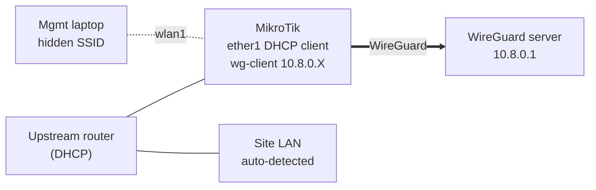

# MikroTik WireGuard Auto-Deploy

One-paste RouterOS v7 script that turns a MikroTik into a **site-to-site WireGuard client**
that plugs into any existing network, figures out the local LAN on its own, and makes that
LAN reachable from your VPN — even when many sites use the same private subnet.

## Why

Dropping a small MikroTik into a customer's network to get remote access usually means
asking what their LAN subnet is, hand-editing firewall and NAT rules, and hoping no other
site uses `192.168.1.0/24` too. This script removes those steps:

- The router is just a **DHCP client** on the existing LAN. No changes to the customer's router.
- When it gets a lease, it **detects the LAN subnet** and patches its own rules.
- Each site gets a **unique mask subnet** (NETMAP), so overlapping LANs are no problem.
- A **hidden management Wi-Fi** gives you a way in even if the LAN or tunnel is broken.

## Features

- DHCP-aware subnet detection: the `dhcp-client` script rewrites the firewall/NAT rules on every lease
- `/32` bypass route to the VPN endpoint via the upstream gateway (avoids routing the tunnel into itself)
- 1:1 **NETMAP** from a per-site mask subnet to the real LAN, for overlapping subnets
- Masquerade for inbound peers, so LAN hosts need no route back to the tunnel
- Masquerade for outbound traffic into the tunnel
- Hidden management SSID on `wlan1` with its own subnet and DHCP pool (`192.168.99.0/24`)
- Netwatch-driven status LED: on = tunnel up
- All settings in one block at the top of the script

## Topology



From the VPN side, host `192.168.1.50` on the site LAN is reached as `10.0.X.50`.
See [docs/topology.md](docs/topology.md) for the full diagram and a packet walk-through.

## Requirements

- MikroTik device running **RouterOS v7.0 or newer** (WireGuard support)
- `ether1` connected to the site LAN, which has a DHCP server with Internet access
- `wlan1` using the legacy **`wireless`** package (`/interface/wireless`), for the management Wi-Fi
- A working WireGuard server, with this client already added as a peer:
  - the client's public key
  - a preshared key
  - `AllowedIPs` covering this client's tunnel IP **and** its mask subnet (e.g. `10.8.0.X/32, 10.0.X.0/24`)
- A free mask subnet for this site (unique across all sites)
- Ideally a **freshly reset device with no default configuration** (see [Known limitations](#known-limitations))

## Setup

1. **Generate a key pair** for the client (on the router or anywhere with `wg`):
   ```bash
   wg genkey | tee client.key | wg pubkey > client.pub
   ```
   Add `client.pub` as a peer on the server with a preshared key and the AllowedIPs above.
2. **Reset the router** without the default config:
   ```
   /system/reset-configuration no-defaults=yes skip-backup=yes
   ```
3. **Copy `deploy.rsc`** to a local file outside this repo and fill in the variables at the top:

   | Variable | Example | Meaning |
   |---|---|---|
   | `wgPrivKey` | `PASTE_CLIENT_PRIVATE_KEY` | client private key |
   | `wgPubKey` | `PASTE_SERVER_PUBLIC_KEY` | server public key |
   | `wgPsk` | `PASTE_PRESHARED_KEY` | preshared key |
   | `wgEndpoint` | `vpn.example.com` | server hostname or public IP |
   | `wgPort` | `51820` | server UDP port |
   | `wgIp` | `10.8.0.42/24` | this client's tunnel address |
   | `wgServerIp` | `10.8.0.1` | server tunnel IP (used by the LED check) |
   | `peerSubnet` | `10.8.0.0/24` | whole tunnel subnet |
   | `maskSubnet` | `10.0.42.0/24` | this site's unique mask subnet |
   | `mgmtSsid` / `mgmtPass` | | management Wi-Fi credentials |

4. **Connect** to the router (WinBox via MAC, or a cable) and paste the whole file into the
   terminal. The outer `{ ... }` block makes it run as a single unit.
5. **Plug `ether1`** into the site LAN. When the lease is bound, the script patches the rules.
6. **Delete your filled-in copy** or store it in a password manager. It contains the keys.

## Verification

```
# DHCP lease bound and LAN detected
/ip/dhcp-client print
/log print where message~"WG-Auto"

# Tunnel up: "last-handshake" should be a few seconds
/interface/wireguard/peers print detail

# Bypass route to the endpoint exists
/ip/route print where comment="VPN Endpoint Bypass"

# NETMAP enabled with the real LAN in to-addresses
/ip/firewall/nat print detail

# Reach the server through the tunnel
/ping 10.8.0.1 count=4
```

From another VPN peer: `ping 10.0.X.<host>` should reach the matching LAN host.

## Troubleshooting

**No handshake**
- Check that the server has the right client public key, preshared key, and AllowedIPs.
- Check that `:resolve vpn.example.com` works on the router, and that the UDP port is open on the server.
- Note: the endpoint IP is resolved **when the lease is bound**. If the server's IP changes,
  renew the lease (`/ip/dhcp-client renew [find interface=ether1]`) to update the bypass route.

**Rules not patched (NETMAP still disabled)**
- Check `/log print where message~"WG-Auto"`. If the lease never reached `bound`, the
  script never ran.
- Did you rename any rule comments? The DHCP script finds rules **by comment**.

**Ping works but TCP stalls (SSH/HTTPS hang, web pages half-load)**
This is an MTU/MSS problem. The tunnel MTU is 1280, but LAN hosts send full 1500-byte
segments, and Path MTU Discovery is often blocked. Clamp the TCP MSS on traffic that
enters or leaves the tunnel:
```
/ip/firewall/mangle add chain=forward protocol=tcp tcp-flags=syn out-interface=wg-client \
    action=change-mss new-mss=clamp-to-pmtu passthrough=yes comment="MSS clamp out WG"
/ip/firewall/mangle add chain=forward protocol=tcp tcp-flags=syn in-interface=wg-client \
    action=change-mss new-mss=1240 passthrough=yes comment="MSS clamp in WG"
```
(1240 = 1280 MTU − 20 IPv4 header − 20 TCP header.) Clamp on the server side too if it routes for other peers.

**Rules exist but traffic is dropped**
A default config, or rules you added earlier, may contain a `drop` rule **above** the rules
this script adds (it appends them at the end). Move the script's rules up, or reset without
defaults before deploying.

**LED does nothing**
`cap-led` exists on cAP-series boards only. On other models, adjust or remove section 5.

## Known limitations

- **Default config:** rules are appended to the end of the chains. On a device with the
  default firewall they may sit below a drop rule. Deploy on a `no-defaults` reset.
- **Wireless package:** section 2 uses `/interface/wireless`. Devices running the newer
  `wifi` (wifiwave2) package need that section rewritten for `/interface/wifi`.
- **Interface names are fixed:** `ether1` (WAN/LAN) and `wlan1` (management).
- **Endpoint IP is resolved on lease**, not continuously (see Troubleshooting).
- **IPv4 only.**
- **Wide-open trust from the tunnel:** `input` and `forward` from `wg-client` are accepted.
  Any peer that can reach this client through the server can manage the router and reach
  the LAN. Restrict on the server side, or narrow these rules for your setup.
- `allowed-address=0.0.0.0/0` accepts any source from the server. RouterOS does **not**
  install routes from `allowed-address`. The bypass route is there in case you add a default
  route through the tunnel later.
- Running the script twice adds duplicate objects. Reset the device first.

## Security

Never commit a filled-in copy of `deploy.rsc`. `.gitignore` ignores `*.local.rsc` and
`secrets/`, so keep your real copies under those names.

## License

[MIT](LICENSE) © 2026 Antonis Karagiannis
