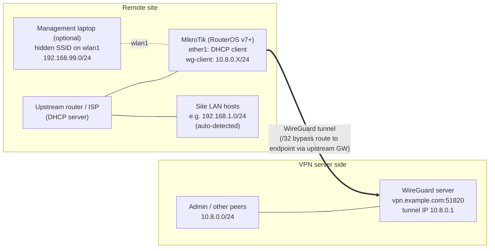

# Topology

## Inbound packet walk-through

A peer reaches LAN host `192.168.1.50` through the site's mask subnet `10.0.X.0/24`:

| Step | Where | Src | Dst |
|---|---|---|---|
| 1 | Peer sends into tunnel | `10.8.0.2` | `10.0.X.50` |
| 2 | dstnat NETMAP on `wg-client` | `10.8.0.2` | `192.168.1.50` |
| 3 | srcnat masquerade (`src 10.8.0.0/24`, `dst LAN`) | `192.168.1.Y` (router's ether1 IP) | `192.168.1.50` |
| 4 | Host replies to router, connection tracking reverses both NATs | | |

Because every site maps its LAN to its own unique mask subnet, two sites can both use
`192.168.1.0/24` and still be reached without conflict.
